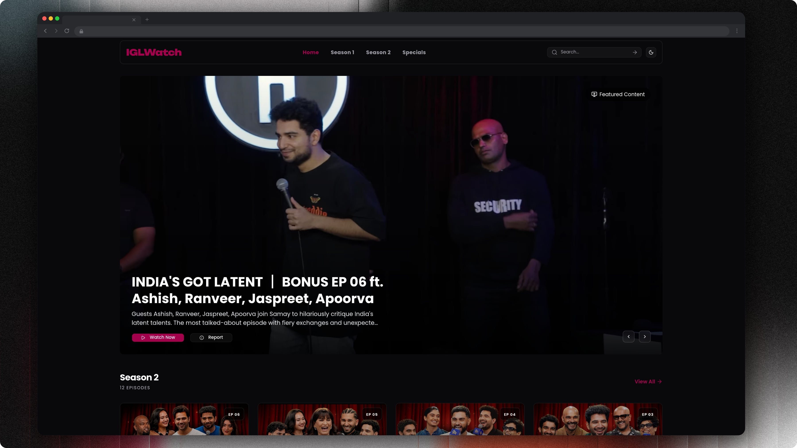

# IGLWatch

<p align="center">
  
</p>

<p align="center">
  <strong>Watch India's Got Latent episodes in one curated fan portal.</strong>
</p>

<p align="center">
  
  
  
  
</p>

IGLWatch is a sleek, fan-managed streaming-style website built with Next.js for browsing and watching episodes of India's Got Latent. It includes season pages, search, episode cards for browsing by release, and a polished modern interface built for quick access to comedy content.

## Highlights

- Beautiful homepage with featured episode sections
- Season-wise browsing for Season 1, Season 2, and Specials
- Searchable episode discovery experience
- Embedded streaming/player links for supported episodes
- Responsive, dark-mode-friendly UI
- Clean static export for easy hosting
- Report flow for UI issues via Discord webhook

## Tech Stack

- Next.js 16
- React 19
- TypeScript
- Tailwind CSS
- shadcn/ui-inspired component system
- Lucide icons
- Framer Motion

## Project Structure

```text
.
├── app/                 # App router pages and routes
├── components/          # Reusable UI and layout components
├── lib/                 # Shared config, fonts, and episode data
├── public/              # Static assets and branding
├── next.config.ts       # Next.js configuration
├── package.json         # Scripts and dependencies
├── tsconfig.json        # TypeScript config
├── eslint.config.mjs    # ESLint config
├── .env                 # Local environment config
└── README.md            # Project documentation
```

## Getting Started

1. Install dependencies:

```bash
npm install
```

2. Start the development server:

```bash
npm run dev
```

3. Open your browser at:

```text
http://localhost:3000
```

## Environment Variables

Create a local `.env` file or update your environment with the required values:

```bash
NEXT_PUBLIC_APP_URL=https://your-domain.example
NEXT_PUBLIC_DISCORD_WEBHOOK_URL=https://discord.com/api/webhooks/your-webhook-url
```

### Notes

- `NEXT_PUBLIC_APP_URL` is used for site metadata and canonical URLs.
- `NEXT_PUBLIC_DISCORD_WEBHOOK_URL` powers the UI report dialog used to send issue reports to Discord.
- Because this project is statically exported, public environment variables are embedded into the client bundle. Use a dedicated, restricted Discord webhook and rotate it if it is ever exposed or abused.

## Available Scripts

```bash
npm run dev      # Start local dev server
npm run build    # Build production bundle
npm run start    # Serve built app locally
npm run lint     # Run ESLint checks
```

## Production Build

```bash
npm run build
npm run start
```

This app is configured for static export via `next.config.ts`, making it suitable for deployment on static hosts or edge-friendly hosting providers.

## Disclaimer

This project is a fan-managed index and media portal for content associated with India's Got Latent. It is not officially affiliated with, endorsed by, or owned by the show's production team or official partners.

## License

This project does not currently declare a formal license. Check the repository status and any upstream usage terms before reusing or redistributing it publicly.

## Contributing

Contributions are welcome if you want to improve the experience, add missing episode data, refine the search flow, or polish the front-end design.

## Support

If you want to extend the project, consider adding:

- improved metadata and filtering
- better episode organization
- richer search indexing
- mobile performance improvements
- accessibility and keyboard navigation refinements
